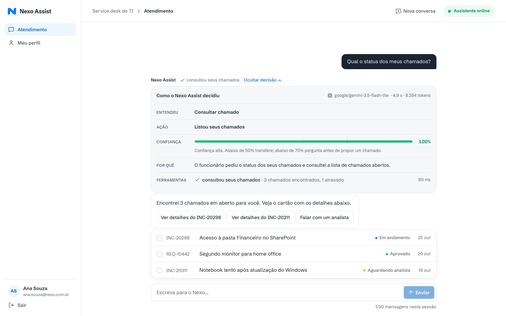
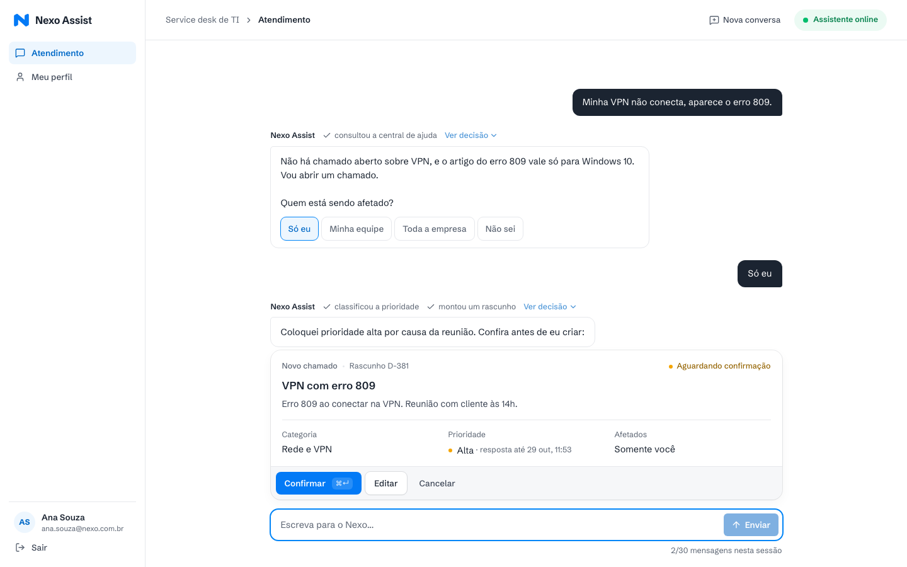
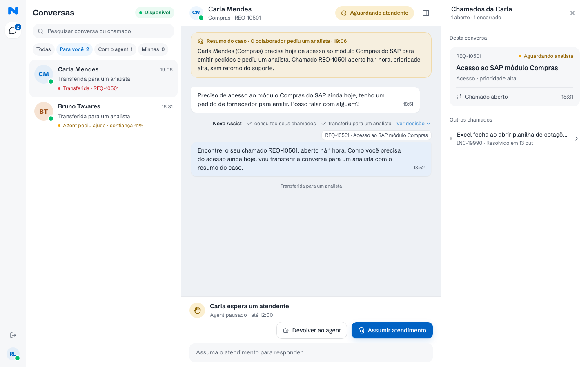
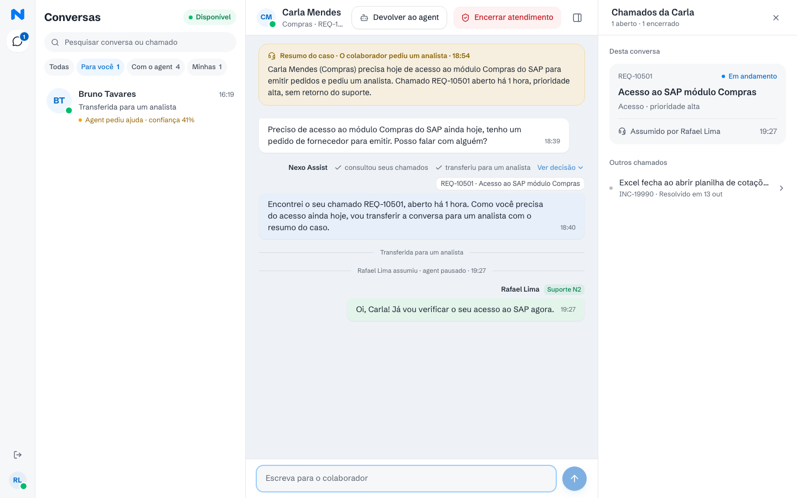
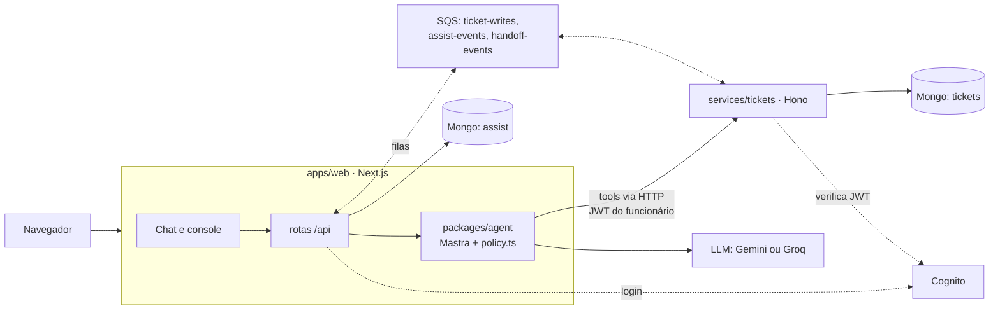

# Nexo Assist

Agent de atendimento do service desk de TI da Nexo, num chat. O funcionário descreve o problema com as
próprias palavras; o agent consulta os chamados dele, busca na central de ajuda, monta rascunhos de
chamado para ele confirmar e chama um analista quando precisa. Cada resposta mostra o que o agent fez e
por quê.

| Chat com o painel de decisão                                              | Rascunho para confirmação                                            |
| ------------------------------------------------------------------------- | -------------------------------------------------------------------- |
|  |                          |
| **Console do analista: conversa transferida**                             | **Console do analista: atendimento assumido**                        |
|     |  |

**Sumário:** [Como rodar](#como-rodar) · [Arquitetura](#arquitetura) ·
[Como o agent decide](#como-o-agent-decide) · [Qualidade das decisões](#como-garanti-a-qualidade-das-decisões) ·
[Trade-offs](#principais-trade-offs) · [Com mais tempo](#o-que-faria-com-mais-tempo) ·
[Modelo e custo](#modelo-e-custo-por-conversa) · [Deploy](#deploy)

---

## Como rodar

### Pré-requisitos

- **Docker** (com Compose). Não precisa de conta AWS: Cognito e SQS rodam no emulador
  [Floci](https://github.com/floci-io/floci).
- **Uma chave de LLM** (gratuita): Google AI Studio para o modelo padrão, Gemini 3.5 Flash-Lite, ou Groq
  (`LLM_MODEL=groq/openai/gpt-oss-120b` no `.env`). Sem chave, dá para usar o modelo roteirizado
  (`LLM_MODEL=demo`, veja abaixo). Trocar de modelo é só mudar `LLM_MODEL` no `.env` e reiniciar.
- Para testes e o loop de desenvolvimento: **Node 24** e **pnpm** (`corepack enable`).

### Subir tudo

```bash
cp .env.example .env          # e preencha GOOGLE_GENERATIVE_AI_API_KEY
docker compose up --build
```

Abra http://localhost:3000. O primeiro start cria sozinho o replica set do MongoDB, os índices, o user
pool do Cognito com os usuários, as filas SQS com as DLQs e os dados de exemplo.

No macOS, a chave pode ficar no Keychain em vez do `.env`:

```bash
security add-generic-password -a "$USER" -s nexo-assist/GOOGLE_GENERATIVE_AI_API_KEY -w   # uma vez
source scripts/env-from-keychain.sh                                                       # por shell
docker compose up --build
```

O web lê a chave no momento do `docker compose up`; se ela entrou depois, rode de novo
`docker compose up -d web`.

Sem chave: coloque `LLM_MODEL=demo` no `.env`. É um modelo roteirizado, usado nos testes e2e: a interface
funciona inteira, mas as respostas seguem um roteiro fixo.

### Usuários de exemplo

Todos com a senha **`nexo123`**.

| Pessoa        | E-mail                      | Papel       | O que tem nos dados                                                                            |
| ------------- | --------------------------- | ----------- | ---------------------------------------------------------------------------------------------- |
| Ana Souza     | `ana.souza@nexo.com.br`     | funcionária | 6 chamados: aguardando analista e vencido, resolvido há 4 dias, resolvido há mais de 7 dias... |
| Bruno Tavares | `bruno.tavares@nexo.com.br` | funcionário | conversa transferida por confiança baixa (41%)                                                 |
| Carla Mendes  | `carla.mendes@nexo.com.br`  | funcionária | conversa transferida (acesso ao SAP para hoje)                                                 |
| Diego Ramos   | `diego.ramos@nexo.com.br`   | funcionário | conversa com o agent, resolvida pela central de ajuda                                          |
| Rafael Lima   | `rafael.lima@nexo.com.br`   | analista    | console do analista (Suporte N2)                                                               |

O PRD pede login "com qualquer senha". Relaxei isso de propósito: o login é real, no Cognito, e o JWT é
o que o serviço de chamados usa para garantir a privacidade. Uma senha fixa e documentada mantém o
fluxo real sem atrapalhar quem avalia.

### Roteiro de 5 minutos

1. Entre como **Ana** e pergunte "Qual o status dos meus chamados?". Escolha o INC-20311: prazo vencido,
   com oferta de chamar um analista. Clique nos chips acima da resposta para abrir o painel de decisão.
2. "Meu notebook não conecta na VPN, erro 809, estou no Windows 11": o agent consulta a central de
   ajuda, pergunta o que falta e monta um rascunho. Só o **Confirmar** cria o chamado.
3. "O SAP bloqueou minha senha de novo, INC-20150": resolvido há 4 dias, então o agent propõe reabrir.
4. Entre como **Rafael**: a conversa da Carla está em "Para você". Assuma, responda e devolva ao agent.

### Comandos úteis

| Comando                                                               | O que faz                                                                                                                                                         |
| --------------------------------------------------------------------- | ----------------------------------------------------------------------------------------------------------------------------------------------------------------- |
| `docker compose run --rm init pnpm --filter @nexo/scripts seed:reset` | Recria os dados de exemplo relativos a "agora" (antes de uma demo)                                                                                                |
| `curl -X POST "localhost:4000/_chaos/outage?ms=25000"`                | Derruba o serviço de chamados por 25 s, para ver o retry e a fila                                                                                                 |
| `pnpm chat ana --nova -m "Qual o horário do service desk?"`           | Conversa com o agent pelo terminal, como um usuário do seed (`-m` repete; sem `--nova` continua a última conversa; comandos `/confirmar`, `/cancelar`, `/estado`) |
| `pnpm --silent dev:token ana`                                         | Access token de um usuário do seed, para usar com `curl`                                                                                                          |

### Loop de desenvolvimento

```bash
pnpm install
cp .env.example .env                    # com a chave, ou: source scripts/env-from-keychain.sh
docker compose up -d mongo floci init   # só a infraestrutura
docker compose stop web tickets         # se estavam no ar: liberam as portas 3000 e 4000
pnpm dev                                # web em :3000 e tickets em :4000, com hot reload
```

### Testes

| Comando                                                         | Precisa                         | O que cobre                                                                                                      |
| --------------------------------------------------------------- | ------------------------------- | ---------------------------------------------------------------------------------------------------------------- |
| `pnpm lint && pnpm format:check && pnpm typecheck && pnpm test` | nada                            | 282 testes unitários: SLA, prioridade, retry, regras do agent, cenários com modelo roteirizado, estado do chat   |
| `pnpm smoke`                                                    | stack no ar                     | init terminou, serviços saudáveis, tela de login renderiza                                                       |
| `pnpm test:integration`                                         | stack no ar                     | 43 testes contra Mongo, Floci e o serviço de chamados reais (o de reinício só roda com `INTEGRATION_RESTARTS=1`) |
| `pnpm test:e2e`                                                 | stack com `FLAKY_ENABLED=false` | 17 testes Playwright no navegador, com o modelo roteirizado                                                      |
| `source scripts/env-from-keychain.sh && pnpm test:evals`        | chave do LLM                    | os 12 cenários com o modelo real (nunca roda na CI)                                                              |

Os e2e sobem um `next dev` próprio na porta 3100 com o modelo roteirizado (não gastam cota de LLM) e
rodam sem retry, então as quedas aleatórias precisam estar desligadas. Ao terminar, eles recriam o seed.

```bash
FLAKY_ENABLED=false docker compose up -d tickets   # desliga as quedas aleatórias
pnpm --filter @nexo/tests exec playwright install chromium   # só na primeira vez
pnpm test:e2e
docker compose up -d tickets                       # religa as quedas
```

A CI (GitHub Actions) roda os quatro primeiros sem nenhum segredo.

---

## Arquitetura



| Peça               | Responsabilidade                                                                                                                                                                                             |
| ------------------ | ------------------------------------------------------------------------------------------------------------------------------------------------------------------------------------------------------------ |
| `apps/web`         | Next.js (App Router): chat do funcionário, console do analista, rotas `/api`, sessão em cookie httpOnly. Roda o agent e é dono do banco `assist` (usuários, conversas, mensagens com a Decision, rascunhos). |
| `packages/agent`   | Agent Mastra, tools, prompt, schema da decisão e `policy.ts` (as regras do Anexo A em código).                                                                                                               |
| `services/tickets` | Serviço de chamados simulado, processo separado: API de chamados e central de ajuda, filtro de privacidade, instabilidade simulada e os consumers SQS. Único dono do banco `tickets`.                        |
| `packages/shared`  | Schemas zod, cálculo de SLA e prioridade (funções puras, testadas), cliente HTTP com retry e as interfaces `AuthProvider` e `EventQueue`.                                                                    |

- **Fronteira de serviço de verdade:** dois bancos no MongoDB. O web nunca lê o banco `tickets`; tudo
  passa pela API, com o token do funcionário.
- **AWS atrás de interfaces:** Cognito (login, grupos `employee` e `analyst`) e SQS (escritas durante
  uma queda e eventos de handoff). O código usa o AWS SDK v3 nos dois ambientes; localmente o endpoint
  é o Floci (`:4566`), online seria a AWS real. Nos testes unitários, implementações em memória.
- **SQS fica fora do caminho feliz:** o funcionário vê o número real do chamado logo após confirmar,
  porque a escrita é síncrona (com retry). A fila só entra quando o sistema continua fora depois dos
  retries.

Diagramas detalhados (componentes, um turno do chat, o caminho da queda e os estados da conversa) em
[docs/architecture.md](docs/architecture.md).

---

## Como o agent decide

**O LLM interpreta; o código aplica as regras.** Um turno, passo a passo
([`run-turn.ts`](packages/agent/src/run-turn.ts)):

1. O web grava a mensagem. Se a conversa está com um analista, para aqui: o LLM não é chamado.
2. O agent recebe as últimas 20 mensagens e a nova. O primeiro passo **precisa** chamar uma tool, para o
   modelo olhar os dados antes de responder.
3. O modelo chama tools de leitura (`search_kb`, `list_my_tickets`, `get_ticket`, `classify_priority`) e
   de proposta (`propose_draft`, `propose_update`, `propose_reopen`, `transfer_to_analyst`). Cada chamada
   real é registrada pelo código (`TurnRecorder`) e vira um chip na tela, em tempo real.
4. O modelo termina com um JSON: `intent`, `extracted`, `action`, `confidence`, `reason` e a resposta,
   que aparece em streaming.
5. `applyPolicy()` ([`policy.ts`](packages/agent/src/policy.ts)) confere a decisão contra o que as tools
   realmente fizeram e aplica as regras do Anexo A. Quando muda algo, registra um `ruleOverride`.
6. A `Decision` final é gravada junto com a mensagem. É ela que alimenta os chips e o painel.

### O que o código garante (e não deixa para o prompt)

| Regra                                  | Como é garantida                                                                                                                                                                                                                                                                                                                         |
| -------------------------------------- | ---------------------------------------------------------------------------------------------------------------------------------------------------------------------------------------------------------------------------------------------------------------------------------------------------------------------------------------- |
| Só cria/atualiza depois da confirmação | O modelo **não tem tool de escrita**. As tools `propose_*` só criam um rascunho. Quem grava é o botão **Confirmar** (`POST /api/drafts/:id/confirm`): muda o rascunho de `pending` para `confirmed` de forma atômica, e `commitDraft` recusa qualquer rascunho que não esteja `confirmed`. Texto digitado ("pode criar") nunca confirma. |
| Privacidade                            | O serviço de chamados filtra por `requesterId` = `sub` do JWT. Chamado de outra pessoa responde 404, seja qual for o prompt.                                                                                                                                                                                                             |
| Agent em silêncio no handoff           | O web só chama o LLM quando o estado da conversa é `agent`.                                                                                                                                                                                                                                                                              |
| Limite de 30 mensagens                 | Contador de mensagens do funcionário na conversa; na 30ª, a entrada trava e oferece "Nova conversa".                                                                                                                                                                                                                                     |
| Sem duplicidade                        | `propose_draft` busca chamados parecidos do funcionário (abertos ou resolvidos há até 7 dias, por busca textual com nota mínima). Se achar, recusa e pergunta se é o mesmo problema. O modelo só cria outro se disser por que é diferente, e o motivo fica na decisão.                                                                   |
| Reabrir só até 7 dias                  | O serviço de chamados recusa (409) depois de 7 dias. Se o funcionário diz que o problema voltou e o chamado pode ser reaberto, o código propõe a reabertura mesmo quando o modelo só perguntou.                                                                                                                                          |
| Prioridade e SLA                       | O modelo informa os fatos (quem é afetado, se há compromisso hoje, se há alternativa); a prioridade sai de uma função pura. O SLA conta horas úteis (seg a sex, 8h às 18h); Crítica conta 1 hora corrida (plantão 24 h).                                                                                                                 |
| Confiança                              | Abaixo de **0,5**: transfere para um analista. Entre **0,5 e 0,7**: não propõe nenhuma escrita, pergunta antes.                                                                                                                                                                                                                          |
| Caso crítico                           | Classificado como Crítico: transfere. Com rascunho, transfere logo após o registro.                                                                                                                                                                                                                                                      |
| Chamado vencido                        | Numa consulta que mostra um chamado vencido, oferece um analista (opções "Sim, falar com um analista" / "Não, obrigado"), uma vez por conversa.                                                                                                                                                                                          |
| Pedido de analista                     | `intent = request_analyst` transfere sempre, com o resumo do caso.                                                                                                                                                                                                                                                                       |
| Fora do escopo                         | RH, financeiro e facilities: só redireciona, nada é registrado.                                                                                                                                                                                                                                                                          |
| Chips honestos                         | `toolsCalled` é preenchido pelo código a partir das chamadas reais. Uma tool que falhou aparece como "tentou consultar seus chamados". Se o modelo diz que montou um rascunho e nenhum foi criado, o código corrige a ação e a resposta.                                                                                                 |

### A Decision e o painel

```ts
Decision = {
  intent, // kb_question | ticket_lookup | ticket_create | ticket_update | ticket_reopen | request_analyst | out_of_scope | ...
  extracted, // ticketId, title, description, type, category, affected, priority, kbArticleIds...
  action, // answer_from_kb | list_tickets | show_ticket | ask_clarification | propose_draft | ... | transfer_to_analyst
  confidence, // 0..1, informada pelo modelo
  reason, // 1-2 frases em PT-BR
  toolsCalled, // preenchido pelo CÓDIGO: tool, rótulo do chip, ok, ms, resumo
  ruleOverrides, // o que o código mudou: { rule, from, to, why }
  source, // 'model' ou 'code' (o turno do Confirmar é decidido pelo código, confiança 1)
  model,
  latencyMs,
  usage,
}
```

Os chips acima de cada resposta vêm de `toolsCalled` ("consultou seus chamados", "classificou a
prioridade"). Clicar neles (ou em "Ver decisão") abre o painel: o que o agent entendeu (intenção e
campos extraídos), a ação, uma barra de confiança com os limites 0,5 e 0,7, o motivo, as tools com
tempo e resultado e, quando houver, **"Regra aplicada pelo sistema"**. Exemplo de override:

> **Confiança baixa** · `ask_clarification → transfer_to_analyst` · Confiança 35% abaixo do limite de 50%.

O analista vê o mesmo painel no console, então entende por que a conversa chegou até ele.

---

## Como garanti a qualidade das decisões

**1. Suíte de cenários** ([`scenarios.ts`](packages/agent/src/scenarios/scenarios.ts)). Cada cenário é
uma mensagem do funcionário, os dados do seed e o resultado esperado (intent, ação, tools, regras). A
mesma suíte roda de dois jeitos:

- **Na CI, com modelo roteirizado:** o "modelo" devolve as tool calls e o JSON do cenário. Isso testa
  tudo o que vem depois do LLM: tools, recusas, `policy.ts`, chips e cards. Rápido e determinístico.
- **Com o modelo real**, atrás de `RUN_LLM_EVALS=1` (`pnpm test:evals`): mede se o modelo entende e
  escolhe certo. Imprime uma tabela com intent, ação, confiança, tokens e latência.

| Cenário                                 | Esperado                                      |
| --------------------------------------- | --------------------------------------------- |
| Dúvida respondida pela central de ajuda | `kb_question` → `answer_from_kb`              |
| Consulta de chamado sem o número        | `ticket_lookup` → `list_tickets`              |
| Chamado atrasado                        | `list_tickets` + oferta de analista           |
| Problema que já tem chamado aberto      | recusa por duplicidade, pergunta se é o mesmo |
| Reabrir chamado resolvido há 4 dias     | `propose_reopen`                              |
| Reabrir fora dos 7 dias                 | recusado pelo código                          |
| Assunto de RH/financeiro                | `redirect_out_of_scope`                       |
| Incidente crítico                       | rascunho com prioridade Crítica               |
| Pedido explícito de analista            | `transfer_to_analyst`                         |
| Mensagem vaga                           | confiança baixa → transfere                   |
| Faltam informações                      | `ask_clarification` antes do rascunho         |
| Chamado de outro funcionário            | não aparece                                   |

**Resultados com o modelo real** (`gemini-3.5-flash-lite`, free tier):

- Antes da verificação independente: **12/12**.
- Depois das correções (28/10): **10/12**. Os 2 que faltaram (confiança baixa e campos faltando) não
  erraram a decisão: falharam com erro de cota do free tier (429).
- Uma nova rodada para este README parou na cota diária (429 `RESOURCE_EXHAUSTED`, 500 requisições por
  dia): 11 dos 12 cenários nem chegaram ao modelo. Para rodar as evals, comece com a cota do dia zerada,
  use `LLM_EVAL_DELAY_MS=5000` para respeitar o limite por minuto, ou troque o `LLM_MODEL`.

**Groq (free tier), disponível via `LLM_MODEL`** (29/10): `groq/openai/gpt-oss-120b` fez **9/12** numa
rodada completa. 2 das 3 falhas (o modelo "chama" uma tool `JSON` inexistente) foram corrigidas depois
pelo retry só de resposta, em rodadas parciais; 11/12 é plausível, mas não foi provado.
`groq/openai/gpt-oss-20b` fez **7/12**.

**2. Regras em funções puras com testes unitários:** SLA (incluindo uma varredura de 336 horas), matriz
de prioridade, retry, `policy.ts` (um teste por override).

**3. Testes de integração (37)** contra a stack real: privacidade (chamado alheio = 404), escritas
idempotentes, reabertura fora do prazo, o ciclo queda → fila → registro, a corrida de dois analistas
assumindo a mesma conversa, o agent em silêncio durante o handoff e um teste que reinicia os containers
e confere que conversas, chamados e estados sobreviveram.

**4. Testes e2e (17, Playwright):** login e roteamento por papel, chat, painel de decisão, rascunho,
limite de mensagens e o handoff completo entre funcionário e console.

**5. Verificação independente.** Depois do agent pronto, uma sessão separada, sem o contexto de quem
escreveu o código, testou o agent contra o PRD. Achou 10 problemas, todos corrigidos com teste:

- o modelo parava em `get_ticket` e perguntava em vez de propor a reabertura → agora o código propõe;
- o consumer da fila aplicava mensagens recebidas logo depois do início de uma queda → agora devolve à fila;
- a busca de duplicados era permissiva demais ("Notebook lento" casava com um problema de VPN) → nota
  mínima de relevância;
- a oferta de analista para chamado vencido aparecia em todo turno → uma vez por conversa;
- um chip de tool que falhou dizia "abriu o chamado" → agora diz "tentou abrir o chamado".

---

## Principais trade-offs

| Decisão                                                          | Por quê                                                                                                                                                                                                                                                                  | Custo                                                                                                                                                                                                     |
| ---------------------------------------------------------------- | ------------------------------------------------------------------------------------------------------------------------------------------------------------------------------------------------------------------------------------------------------------------------ | --------------------------------------------------------------------------------------------------------------------------------------------------------------------------------------------------------- |
| **Gemini 3.5 Flash-Lite, free tier**, em vez de Claude Haiku 4.5 | Custo zero para desenvolver e avaliar, e o modelo é bom o bastante com as regras no código. O provedor é configurável no `.env`: `LLM_MODEL=groq/openai/gpt-oss-120b` (9/12 nas evals) ou `anthropic/claude-haiku-4-5` funcionam sem mudar código.                       | Limites do free tier (~15 req/min e 500 req/dia). Um turno faz 2 a 4 chamadas ao modelo; a suíte de evals consegue esgotar a cota do dia. O `gemini-3.5-flash` (sem Lite) tem só 5 req/min, pouco demais. |
| **JSON no system prompt**, não o modo JSON nativo                | Com o modo nativo, o Flash-Lite deixava de chamar tools (6/12 cenários contra 10-12/12).                                                                                                                                                                                 | ~3 mil tokens de entrada por chamada só com prompt e schema.                                                                                                                                              |
| **Polling (4 s)** em vez de SSE/WebSocket para handoff e console | Simples de explicar, roda em qualquer host Node, sem conexão longa. A resposta do agent já chega em streaming (NDJSON).                                                                                                                                                  | A mensagem do analista leva até 4 s para aparecer.                                                                                                                                                        |
| **Floci** como emulador de Cognito e SQS                         | O LocalStack passou a exigir conta e token desde março de 2026, e quem avalia teria que se cadastrar. Comecei com cognito-local + ElasticMQ (dois containers, ajustes de compatibilidade) e troquei pelo Floci depois de um spike: um container, licença MIT, sem conta. | Emulador menos maduro que a AWS; por isso o código só muda endpoint e credenciais entre os ambientes.                                                                                                     |
| **MongoDB sem Mastra Memory**                                    | O analista também escreve na conversa, e a memória do Mastra só modela usuário e agent. O histórico mora em `assist.messages`, e o agent recebe as últimas 20 mensagens a cada turno.                                                                                    | Não uso a memória semântica do Mastra.                                                                                                                                                                    |
| **Eventos de handoff best effort**                               | A transição de estado é a fonte da verdade (update atômico no Mongo). O evento SQS alimenta a timeline do chamado e a auditoria; se a fila falhar, o handoff não é desfeito.                                                                                             | Uma falha de fila pode deixar uma linha faltando na timeline.                                                                                                                                             |
| **Seed relativo a "agora"**                                      | "Vencido", "resolvido há 4 dias" e "há 6 dias" continuam verdadeiros em qualquer dia em que a app rodar.                                                                                                                                                                 | Os dados envelhecem depois do primeiro start; `seed:reset` os renova.                                                                                                                                     |
| **Instabilidade simulada**                                       | O serviço de chamados cai de 3 a 8 s, em média a cada 2 min (`FLAKY_*`), e tem o endpoint `/_chaos/outage` para forçar uma queda numa demo.                                                                                                                              | Para os e2e, que rodam sem retry, a instabilidade aleatória fica desligada (`FLAKY_ENABLED=false`); as quedas são testadas de forma determinística na integração.                                         |

### Como interpretei pontos em aberto do PRD

- **30 mensagens por sessão:** sessão = conversa, contando só as mensagens do funcionário. Ao voltar
  outro dia, o funcionário cai na última conversa aberta ("continuar de onde parei").
- **Chamado vencido:** o protótipo oferece o analista e o Anexo A diz para transferir. Sigo o protótipo:
  ofereço, e transfiro no "sim".
- **Relógio do SLA:** começa na abertura e reinicia a cada atualização do suporte.
- **Status:** aberto, em andamento, aguardando analista, aprovado (só REQ), resolvido, encerrado. Só
  "resolvido" pode ser reaberto.
- **"Resolução sem fila"** (critério do PRD) é resolver sem passar pela fila de atendimento humano. Não
  tem relação com as filas SQS, que são infraestrutura.

---

## O que faria com mais tempo

- **SSE** no lugar do polling, para o console e as mensagens do analista chegarem na hora, e
  **notificações** no console quando uma conversa nova é transferida.
- **Atribuição entre vários analistas:** hoje há uma fila única. Também falta uma trava (bead `nx-m4x`):
  qualquer analista consegue devolver ou encerrar uma conversa que outro está atendendo.
- **Estado de leitura por analista** (o que já vi / o que é novo na lista).
- O link **"Ver todos os chamados"** do painel lateral do console ainda não leva a lugar nenhum.
- **Cortar tokens** (bead `nx-ad1`): prompt e schema custam ~3 mil tokens por chamada; dá para encurtar
  o schema e cachear o prompt.
- **Traces do Mastra** no MongoDB (`@mastra/mongodb`), para ver cada passo do modelo além da Decision.
- **Mais cenários de eval**, rodando com mais de um modelo e com várias repetições por cenário, para
  medir variância e não só acerto.
- Bug visual (bead `nx-8n4`): no console a 1440 px, com o painel lateral aberto, o botão "Assumir
  atendimento" fica cortado na borda.
- Bug menor de setup (bead `nx-c42`): se `pnpm init:local` rodar no host antes do init do Docker, o
  replica set pode gravar o host errado.

---

## Modelo e custo por conversa

Medido nas evals com o modelo real: **~8,3 mil tokens de entrada e ~0,5 mil de saída por turno** (de 6,6
a 15,8 mil de entrada, conforme quantas tools o turno chama). Cerca de 3 mil tokens de cada chamada são o
system prompt mais o schema da decisão. Uma conversa típica tem ~8 turnos do agent: **~70 mil tokens de
entrada e ~4 mil de saída**.

| Modelo                                    | Preço (entrada / saída por 1M tokens) | Por conversa          | Por 1.000 conversas       |
| ----------------------------------------- | ------------------------------------- | --------------------- | ------------------------- |
| Gemini 3.5 Flash-Lite, free tier (padrão) | grátis                                | US$ 0                 | US$ 0, limitado pela cota |
| Gemini 3.5 Flash-Lite, pago               | US$ 0,30 / US$ 2,50                   | ~US$ 0,03             | ~US$ 31                   |
| Groq gpt-oss-120b, free tier              | grátis                                | US$ 0                 | US$ 0, limitado pela cota |
| Groq gpt-oss-120b, pago                   | US$ 0,15 / US$ 0,60                   | ~US$ 0,01             | ~US$ 13                   |
| Claude Haiku 4.5                          | US$ 1 / US$ 5                         | ~US$ 0,09 (sem cache) | ~US$ 90                   |

Limites do free tier: no Gemini Flash-Lite, ~15 requisições por minuto e 500 por dia; na Groq
(gpt-oss-120b), 30 por minuto e 1.000 por dia, mas só 8 mil tokens por minuto e 200 mil por dia, o que
dá ~1 turno por minuto. A parte fixa do prompt vem primeiro para o provedor cachear (na Groq, tokens em
cache não contam no limite e custam metade). Para uso real, o plano pago é necessário.

Para economizar modelo: o turno do **Confirmar** não chama o LLM (é decidido pelo código), e uma conversa
com analista não chama o LLM.

---

## Deploy

**No ar em https://aly-nexo-assist.wip.rest** (usuários e senha de exemplo acima). O roteiro completo,
com as decisões, está em **[docs/deploy.md](docs/deploy.md)**. Em resumo:

- **App:** web e tickets como dois processos Node de longa duração num **VPS próprio**, atrás de HTTPS;
  só o web fica exposto. O driver do MongoDB e os consumers SQS precisam de processos que não dormem,
  então Workers/serverless não servem.
- **Banco:** MongoDB Atlas M0 (gratuito, 512 MB), com um usuário só com `readWrite` em `tickets` e
  `assist`.
- **AWS real, por Terraform (`infra/`):** user pool do Cognito, as três filas SQS com DLQs, um usuário
  IAM por serviço só com as filas e ações SQS que o código usa (o login do Cognito não precisa de IAM) e
  um alerta de AWS Budget de US$ 5. As chaves de acesso ficam fora do state do Terraform.
- **Segredos:** só nos secrets da plataforma, nunca no git nem na imagem. Com `APP_ENV=production` os
  serviços recusam subir sem uma variável obrigatória ou com um endpoint de emulador; o endpoint de caos
  fica desligado pelo código.
- **Contra abuso e custo:** limites do LLM que contam o que o provedor conta, chamadas ao modelo e
  tokens: por usuário por dia (40 mil tokens) e globais por minuto (12 chamadas, 6 mil tokens) e por dia
  (400 chamadas, 160 mil tokens), dentro dos free tiers do Gemini e da Groq; chaves separadas para dev e
  para a demo; rate limiting no login e no `/api/chat`.
  Tudo configurável por env e com aviso claro no chat.
