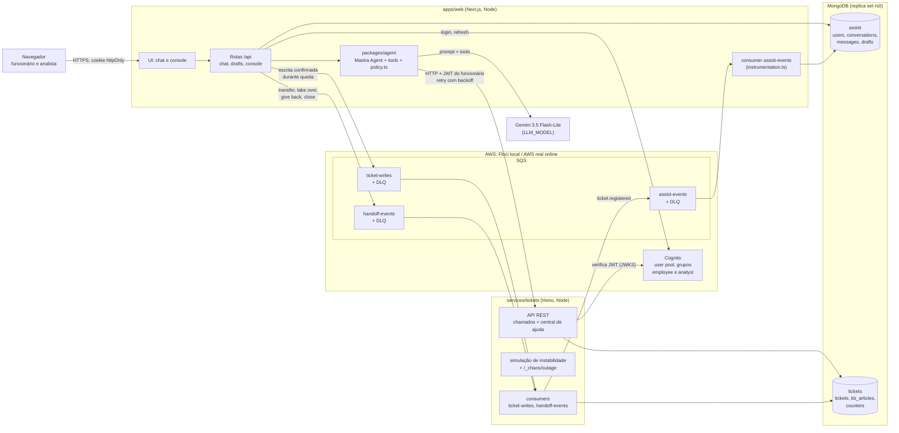
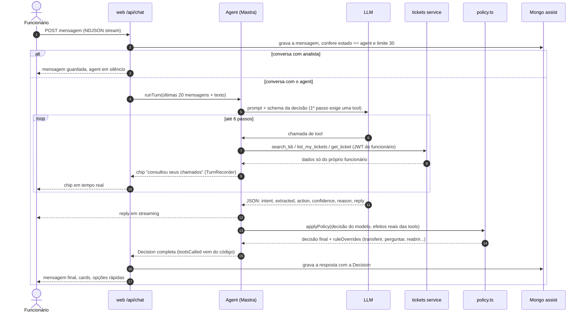
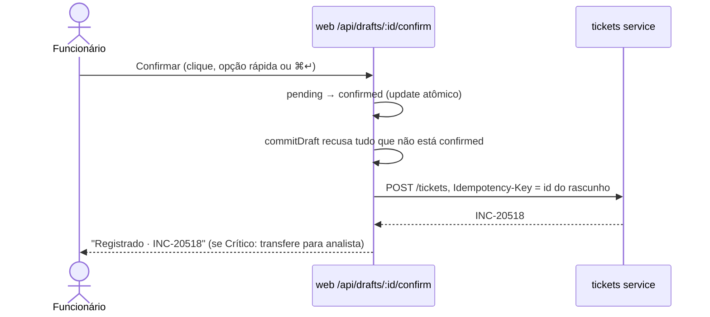
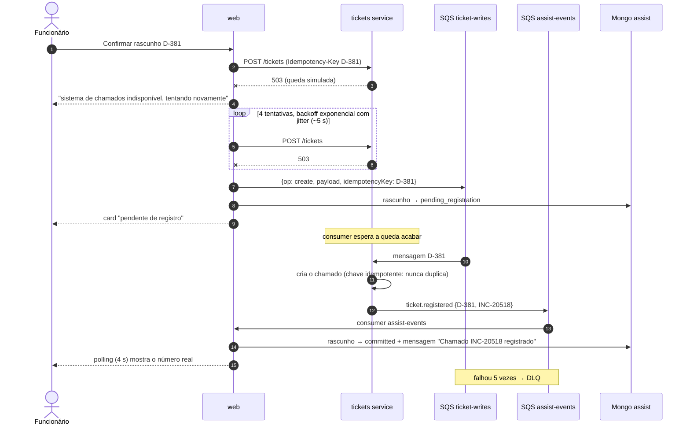
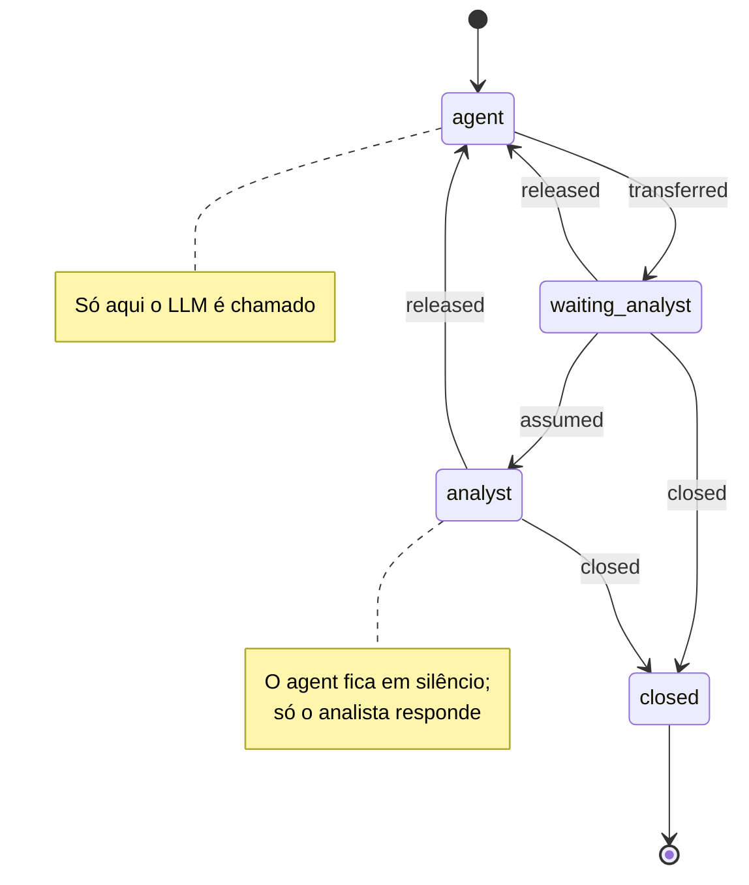

# Arquitetura

Visão detalhada do Nexo Assist. O [README](../README.md) tem o resumo; aqui ficam os diagramas e os
fluxos que o README só cita.

## Componentes

**Fronteira de serviço.** Só o tickets service lê e escreve o banco `tickets`; só o web lê e escreve o banco
`assist`. O web nunca abre o banco de chamados: tudo passa pela API HTTP, com o access token do
funcionário. O filtro de privacidade (`requesterId = sub do JWT`) mora no tickets service, então nenhum
prompt consegue ver chamado de outra pessoa: um chamado alheio responde 404.

**AWS atrás de interfaces.** `AuthProvider` (Cognito) e `EventQueue` (SQS) ficam em `packages/shared`,
com implementações em memória para os testes unitários. O código usa o AWS SDK v3 nos dois ambientes; só
mudam o endpoint e as credenciais (Floci em `:4566` localmente).

| Fila             | Produtor | Consumidor | Para quê                                                         |
| ---------------- | -------- | ---------- | ---------------------------------------------------------------- |
| `ticket-writes`  | web      | tickets    | escrita confirmada que não passou durante uma queda              |
| `assist-events`  | tickets  | web        | resultado dessa escrita (`ticket.registered` / `write_failed`)   |
| `handoff-events` | web      | tickets    | transferência, assumir, devolver, encerrar: timeline e auditoria |

Cada fila tem uma `<nome>-dlq`; uma mensagem recebida 5 vezes sem sucesso vai para a DLQ.

## Um turno do chat

O modelo **não tem tool de escrita**. `propose_draft`, `propose_update` e `propose_reopen` só criam um
rascunho no banco `assist`. Quem grava o chamado é o botão **Confirmar**:

## Queda do sistema de chamados

A leitura (consultar chamados, central de ajuda) usa o mesmo retry, mas não vai para a fila: se o sistema
continua fora, a tool falha, o chip aparece como "tentou consultar seus chamados" e o agent avisa.

## Estados da conversa

- Cada transição é um único `findOneAndUpdate({ _id, state: <origem> })`. Se dois analistas clicam em
  "Assumir atendimento" ao mesmo tempo, só um ganha.
- A transferência acontece por pedido do funcionário, caso crítico, chamado vencido (oferecida, com
  "sim") ou confiança abaixo de 0,5. Ela grava um resumo do caso, que o analista vê no console.
- Cada transição grava uma mensagem de sistema (o divisor "Transferida para Suporte N2 · 10:05") e
  publica um evento em `handoff-events` (`transferred`, `assumed`, `released`, `closed`). O tickets
  service põe o evento na timeline do chamado relacionado, que aparece no painel lateral do console.
- O evento é best effort: se a fila falha, a transição já aconteceu e não é desfeita.

## Persistência

| Banco     | Coleção         | Índices principais                                                                        |
| --------- | --------------- | ----------------------------------------------------------------------------------------- |
| `tickets` | `tickets`       | `{requesterId, status}`, `{updatedAt}`, texto em título/descrição, `idempotencyKey` único |
| `tickets` | `kb_articles`   | texto em título/corpo/tags                                                                |
| `tickets` | `counters`      | sequência de INC e REQ (`$inc`)                                                           |
| `assist`  | `users`         | `email` único (cópia do perfil; o Cognito é a fonte)                                      |
| `assist`  | `conversations` | `{state, assignedAnalystId, lastMessageAt}`, `{employeeId, lastMessageAt}`                |
| `assist`  | `messages`      | `{conversationId, createdAt}`; a Decision vai junto da mensagem                           |
| `assist`  | `drafts`        | `{conversationId, status}`                                                                |

Os índices são criados no start de cada serviço. Nenhum fluxo precisa de transação multi-documento:
escritas são de um documento só, e a idempotência vem de chave única ou de filtro
(`'timeline.key': {$ne: key}`).
